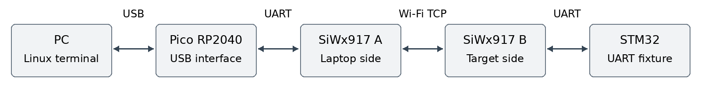

# Wireless UART demonstration guide

28 October 2026 | Pico RP2040 and SiWx917 pair | Linux

Use this guide for a limited functional demonstration of wireless text, baud selection, reset and ROM boot entry. Those functions passed on the restored 3.9.1 bundle. Fresh sustained-load checks failed at both 115200 and 921600, and standard flashing-tool compatibility remains unqualified. Do not present this setup as fully accepted or start a live endurance demonstration. The companion testing report records the failures as well as the passes.

## 1 Prepare the setup



**Application data follows this path in both directions:** PC USB → Pico → UART → A → Wi-Fi TCP → B → UART → STM32. No router is needed.

**A USB is for power and programming or debugging. It carries no application payload in this variant.** B USB provides power and diagnostics. Nucleo ST-LINK USB provides power and separate fixture control. Removing a power cable stops that board unless another supply is connected.

### Keep these jumper connections

| From | To |
| --- | --- |
| Pico GP0 TX pin 1 | A GPIO29 RX EXP11 |
| Pico GP1 RX pin 2 | A GPIO30 TX EXP13 |
| Pico GND pin 3 | A GND EXP1 |
| B GPIO30 TX EXP13 | Nucleo D2 PA10 RX CN9 pin 3 |
| B GPIO29 RX EXP11 | Nucleo D8 PA9 TX CN5 pin 1 |
| B GND | Nucleo pin marked GND |
| B GPIO25 EXP3 | Nucleo NRST CN6 pin 3 |
| B GPIO26 EXP5 | Nucleo BOOT0 CN7 pin 7 |

This is the photographed NUCLEO-L452RE MB1136 Rev C. D0 and D1 are not the fixture UART. Do not add a Pico 3V3, VSYS or VBUS power jumper. Power off before changing wires.

### Identify the ports

Open a Linux terminal and run these commands. Keep this terminal open for later steps.

```bash
cd /home/ghost/SimplicityStudio/v6_workspace
python3 docs/demo-support.py ports
```

Expected: Pico data, Pico status and STM32 fixture all show a device path. The last checked paths were ttyACM3, ttyACM4 and ttyACM2, respectively. They can change. A is serial 440332408; B is 440332624. Select the Pico data port for payload, not either J-Link port.

<!-- pagebreak -->

## 2 Show ordinary serial data in nRF

The installed nRF Connect Serial Terminal is version 1.6.5. Its settings lock while connected, and it has no manual DTR or RTS control buttons. Use the short Linux release command below after each data-port connection. The RTS/CTS setting is flow control; it is not a manual RTS button.

### Open the correct port

1. Open nRF Connect for Desktop → Serial Terminal.
2. Click Select Device and select Wireless UART Pico bridge, serial E66488C15F39C034.
3. Under Serial Port, choose the Pico data path printed on page 1. Do not choose the Pico status port for this step.
4. Set Baud Rate 115200, Data bits 8, Stop bits 1, Parity none. Set RTS/CTS, xOn, xOff and xAny all off.
5. Choose Line mode and Line Ending LF. Click Connect to port.
6. Leave nRF connected. In the Linux terminal, run:

```bash
python3 docs/demo-support.py release
python3 docs/demo-support.py status
python3 docs/demo-support.py fixture --baud 115200
```

**Expected:** status shows ready 1, baud 115200, parity N, dtr 0 and rts 0. Fixture replies `OK 115200` followed by two numbers. Wait one second before sending payload. The release command clears reset and BOOT0 without changing baud or reading nRF payload.

### Send three clear messages

In the bottom line input, type each message and press Enter or click Send. Send one at a time:

```text
DEMO_001_HELLO
DEMO_002_0123456789
DEMO_003_ABCDEFGHIJKLMNOPQRSTUVWXYZ
```

**Pass:** each message appears in the received output exactly as sent. Point to received data, not only the terminal's sent entry. The STM32 fixture echoes bytes; it does not interpret these strings as commands.

**Say:** “This is a normal USB serial port. The data reaches the STM32 through the two wireless modules and returns through the same path.”

### If nothing comes back

- Check the selected port. Payload belongs on Pico data, not Pico status, A J-Link or B J-Link.
- Run release, then status, then fixture again in that order. Send only after the expected acknowledgement.
- If a device is MISSING, check its USB data cable and power. Do not reflash to solve a missing USB connection.
- If a command reports port busy, stop the other program using that port. For release only, keep nRF data open; do not run the automated tester alongside it.
- Startup or reset may produce transition bytes. Clear the display after settling, then begin the demonstration. Unexpected bytes during an active payload test are a failure.

<!-- pagebreak -->

## 3 Show baud changes and remote boot control

### Requirement 5 Forward the laptop baud selection

This changes B's UART setting. The STM32 application must independently use the same baud, just as with a wired adapter. Our adjustable fixture uses its ST-LINK port for that bench setup.

1. Stop sending. Click Disconnect from port in nRF.
2. Enter 921600 in Baud Rate. Type the number if it is not in the preset list. Keep 8 data bits, 1 stop bit, no parity and all flow control off.
3. Click Connect to port. Run:

```bash
python3 docs/demo-support.py release
python3 docs/demo-support.py status
python3 docs/demo-support.py fixture --baud 921600
```

4. Confirm ready 1, baud 921600, parity N, dtr 0 and rts 0. Wait one second; send `DEMO_BAUD_921600` and show its exact received copy.
5. Repeat the same steps with 115200 and send `DEMO_BACK_115200`. Finish at 115200.

**Pass:** B acknowledges each requested setting and the matching fixture echoes correctly. No firmware flash or custom baud-forwarding PC app is needed. nRF requires a disconnect to edit its setting; the saved automated test separately proved all six rates on one open COM handle.

### Requirement 6 Show USB DTR and RTS controlling reset and BOOT0

nRF cannot directly perform the required manual signal sequence. Use the already verified feature tester for this part.

1. Click Disconnect from port in nRF. Close any separate Pico status or STM32 fixture terminal sessions too. Keep all four USB cables and all jumper wires connected.
2. In the Linux terminal, run:

```bash
python3 experiments/pico-bridge/tools/check_pico_features.py
```

3. The tool first checks baud forwarding with binary echoes. Then it drives USB DTR and RTS, selects 115200 8E1, resets into the STM32 ROM, and reads the chip ID.
4. Show `PASS USB DTR/RTS` with chip ID `0462`, followed by `PASS application restored at1152008N1 with exact echo`.
5. Return to nRF at 115200 and repeat page 2's connect, release, status and fixture steps. Show one final echo.

**Pass:** ROM ACK 79, chip ID 0462 and an exact application echo after restoration. DTR asserted holds NRST low; RTS asserted sets BOOT0 high. The tool sets BOOT0 while reset is held, then releases reset. Normal data needs both signals released.

This is a read-only bootloader demonstration. It does not erase or program flash. The standard STM32CubeProgrammer connection attempt on the experimental A 3.9.2 candidate failed, so no erase or write followed. Programming on the restored A 3.9.1 remains unqualified. Do not select nRF's Nordic Programmer app for the STM32.

<!-- pagebreak -->

## 4 Show batching power policy and buffering

### Requirement 1 Send batches and flush short messages

1. In nRF at 115200, send `SHORT_BATCH_TEST` once, then stop typing.
2. Show that the complete response returns without waiting for a large buffer to fill.
3. For the implementation evidence, open `experiments/pico-bridge/firmware/Debugger-SiW917_station/app.c`. Show the comment “Batch to one TCP MSS or four milliseconds of actual UART idle.”

**What this proves:** short data is not stranded waiting for a full batch. B's target-to-network path fills up to 1,440 payload bytes or flushes after about 4 ms of UART idle.

**Implementation and evidence:** Pico batches up to 256 bytes or 2 ms of actual USB idle. A forwards these bounded batches. The earlier passing ten-minute run on the restored image hashes recorded 27000 full Pico batches for 6912000 bytes. Native tests cover short-read coalescing and the idle deadline. Short echoes demonstrate that small messages flush. This batching evidence does not override the later endurance failure.

### Requirement 2 Keep Wi-Fi in high performance mode

This is a firmware policy, not an nRF terminal setting.

1. Stop sending traffic. Leave A and B USB connected for debugger access.
2. Run the policy readback command below. It reads status using the matching experimental firmware symbols; it does not flash either board.

```bash
python3 docs/demo-support.py policy
```

3. Show `bridge_power_status` 0, `bridge_power_profile` 0 and read_ok true for both boards. The command prints a JSON report location.
4. Open `experiments/pico-bridge/firmware/wireless_receive.h` and show `SL_WIFI_SYSTEM_HIGH_PERFORMANCE`. B explicitly applies the policy after joining.

**Pass for software policy:** successful readback and high performance configuration. A cached profile value alone is not proof of a new NWP command. This check does not measure radio power consumption or establish a latency bound.

### Requirement 3 Buffer data and check every returned byte

The bench uses UART DMA, queues and transport acknowledgements. Physical UART RTS/CTS flow-control wires are not fitted; the two USB control signals are used for reset and boot.

- Show the saved Pico functional report: seven baud selections each passed 4,096 exact bytes in both directions; a further 256-byte echo passed after bootloader exit.
- Show the preserved one-hour 921600 report: 331,776,000 exact bytes each way at 92,160 bytes/s. State that it belongs to the earlier A/B 3.7.2 images, before the Pico interface.
- Show the timed results from the companion testing report. A readable terminal screen alone cannot prove zero byte loss or full-capacity throughput.

**Current status:** short functional integrity passed. A ten-minute 115200 pass was recorded, but the fresh confirmation on the same image hashes failed after about 95 seconds. Full-capacity 921600 checks also failed. Sustained zero-loss operation is not currently reliable.

<!-- pagebreak -->

## 5 Show reconnect latency and range

### Requirement 4 Recover without reopening the laptop COM port

1. Finish the page 2 setup at 115200. If nRF offers Auto-reconnect, turn it off. Leave the data port open throughout.
2. Send `BEFORE_DROP_001` and show its received copy.
3. Press and release the RESET button on B only. Keep Pico, A and the STM32 powered. Start a stopwatch when releasing B's reset. Do not unplug the Pico or click Disconnect.
4. Wait for B to rejoin. Send a fresh numbered message once per second, starting with `AFTER_DROP_001`, until one is echoed exactly.
5. Record the time to the first correct reply and confirm nRF stayed connected.

**Pass:** fresh data resumes on the existing COM session without a laptop port reopen. This demonstrates recovery after a radio reset. It does not prove an RF-only outage case or preserve bytes sent during the outage. A factory reset or USB disconnection is not this test.

The restored bundle recovered after B reset in 21.093 seconds and A reset in 34.231 seconds, using one open COM handle and 4096 exact bytes after each recovery. These are observed times, not guaranteed bounds. Six additional cycles passed on the rejected A 3.9.2 candidate and qualify only that variant.

### Acceptance test Measure typical and largest observed latency

1. Disconnect nRF and close other Pico or fixture terminal sessions.
2. Keep all four boards connected. Run:

```bash
python3 docs/demo-support.py latency --baud 115200
```

3. Show the report's median, p95 and maximum observed milliseconds for 1, 32, 256 and 1,024-byte messages. Each size uses 50 exact echo samples.

**Pass for measurement:** no byte mismatch and a saved report for every size. These are round-trip times including USB, both radios and the STM32 echo. The largest sample is not a guaranteed worst case. No numerical latency limit was supplied, so compare the measured values with the agreed target before declaring latency acceptance.

### Acceptance test One wall and two walls

1. Return to nRF at 921600 using the baud-selection steps on page 3. Configure the fixture to 921600 and confirm an exact echo at the desk. This matches its startup baud if target power is cycled when moving it.
2. Keep Pico and A at the laptop. Move powered B and the STM32 together behind one wall. Keep all five target wires connected. Use a power bank or local supply if needed.
3. Record approximate distance, wall material and number of walls. Send 20 numbered messages and check all 20 received copies.
4. Repeat behind two walls. Record each placement separately. Do not declare a range pass if messages are missing.

**Pass for the short placement check:** 20 exact replies at the recorded placement. This is not an endurance or guaranteed range result. No verified wall-range pass is currently recorded. Timed binary testing at the same placement is the stronger follow-up.

<!-- pagebreak -->

## 6 Timed tests and meeting checklist

### Acceptance test Continuous exact binary data

Disconnect nRF and all Pico or fixture terminal sessions first. Keep the fixture ST-LINK USB attached. The supporting tool configures the fixture, releases reset and compares every returned byte. It records requested and actual sending time, byte counts, hashes and errors. Only a final PASS qualifies the requested run.

The following commands are engineering procedures for after the sustained-load issue is resolved. They are not recommended for the live presentation. A short full-capacity 115200 request is:

```bash
python3 docs/demo-support.py endurance --baud 115200 \
  --seconds 10 --rate 11520
```

**Expected on a pass:** 115,200 exact bytes in each direction, matching SHA256, exact_bytes_passed true, offered_load_met true and passed true. Save the printed report. A failed offered-load check means the requested rate was not sustained even if the returned bytes match.

For the requested acceptance duration, run each command separately. Do not inject outages during an endurance run.

```bash
python3 docs/demo-support.py endurance --baud 115200 \
  --seconds 86400 --rate 11520
python3 docs/demo-support.py endurance --baud 921600 \
  --seconds 86400 --rate 92160
```

| Setting 8N1 | Payload each direction | Expected bytes each way in 24 hours |
| --- | --- | --- |
| 115200 | 11,520 bytes/s | 995,328,000 |
| 921600 | 92,160 bytes/s | 7,962,624,000 |

Neither 24-hour test has passed. The restored bundle has functional passes and an earlier 600 s 115200 pass, followed by a failed fresh 115200 confirmation. High-rate offered-load and integrity checks also failed. Resolve those failures before a 24-hour attempt. The older one-hour result does not qualify this Pico path.

### Suggested meeting order

1. Show the hardware and the data-path diagram. Explain that A USB is power/debug only.
2. Show three exact text echoes in nRF.
3. Show 115200 → 921600 → 115200 with matching fixture settings.
4. Close nRF and show the verified USB reset and ROM identification tool, or its saved result.
5. Show batching and power-policy evidence, then the saved integrity results. Present pending measurements clearly.
6. Demonstrate reconnect or wall placement only if planned. Record the outcome, including failures.

**Close with:** “Wireless text, baud forwarding, USB reset and ROM entry passed functional checks. Reconnect and latency were measured on the restored bundle. Sustained traffic is still failing, so full-capacity and 24-hour operation are not accepted. Standard flashing-tool compatibility and wall range remain open.”

<!-- pagebreak -->

## 7 Evidence and test record

### Use these saved results

| Evidence | File from the workspace root |
| --- | --- |
| Current Pico functional pass and tested hashes | experiments/pico-bridge/qualification-2026-10-28/final-features.json |
| Earlier one-hour 921600 verification | docs/2026-10-27-budgeted-heap-one-hour-verification.json |
| Earlier manual baud matrix | docs/2026-10-27-manual-baud-test-report.md |
| Current requirement history and scope | docs/client-requirements-status.md |
| Current Pico wiring and implementation | experiments/pico-bridge/README.md |

The final-feature report identifies A/Pico 3.9.1, B 3.9.0 and STM32 fixture 3.8.0 with exact image hashes. The companion testing report indexes the final latency, recovery and failed endurance results. Earlier results qualify only their recorded images.

### Fill this in during the demonstration

| Item | Result or observation |
| --- | --- |
| Date and firmware identity | |
| Ordinary nRF echo | PASS or FAIL |
| USB baud forwarding | PASS or FAIL |
| USB reset and ROM ID 0462 | PASS or FAIL |
| Return to application | PASS or FAIL |
| Batching evidence | 256-byte or 2 ms batching; saved counters and native idle tests |
| Power policy readback | A and B values; report file |
| Timed integrity | Baud, seconds, bytes, hashes, report file |
| Reconnect | Seconds; same COM stayed open yes or no |
| Latency | Median, p95, maximum observed; report file |
| Wall placement | Distance, material, wall count, received out of 20 |
| Remaining work | Record incomplete or failed criteria |

### Important tool notes

- `check_pico_features.py` is hardware verified. Rerun it only for a requested live demo or a relevant firmware change.
- `demo-support.py` was bench checked for default-open/release text echoes, fixture selection, latency, policy and endurance reporting. Its endurance tests found real failures. Actual nRF GUI clicks were not driven. It uses the existing Linux pySerial environment.
- Release only clears DTR/RTS on the open nRF data port. Do not run another payload reader beside nRF.
